
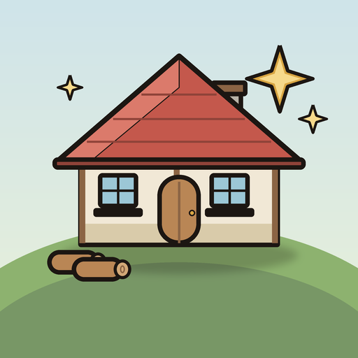

# Merge & Rebuild

**Birleştir. Üret. Onar. Köyünü koru.** · *Merge. Make. Mend. Defend your village.*

Hikâye odaklı bir **merge-2 köy onarma oyunu** (iOS ve Android) · Unity 6 (URP) · Türkçe + English

*A story-driven merge-2 village-restoration game for iOS and Android.*

> Bu depo yalnızca oyunun tanıtımıdır; kaynak kod ve oyun varlıkları yayımlanmaz.
> This repository is a showcase only; source code and game assets are not published.

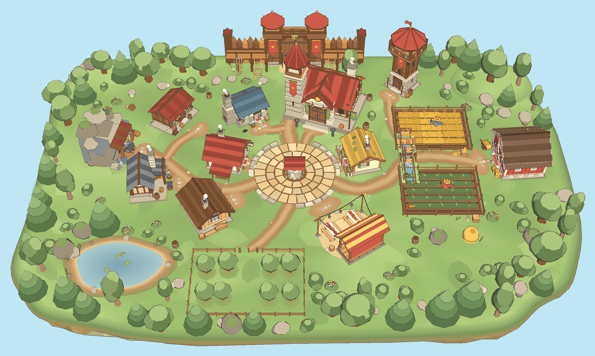

## Yıkıktan canlıya / From ruins to life

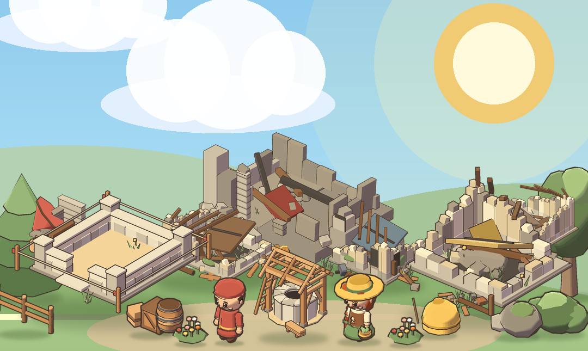
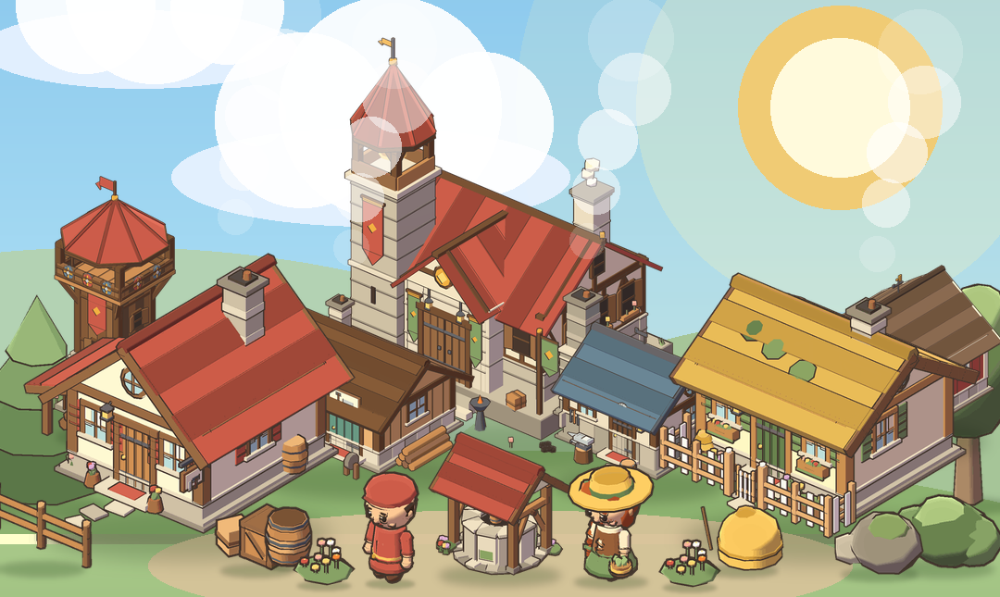

Benzer malzemeleri daha iyi malzemelere birleştir, görevlere teslim et ve yıkık bir köyün yeniden canlanışını izle: önce evler, sonra tarlalar, sonra akıncılara karşı savunma.

*Merge matching items into better materials, deliver them to quests, and watch a ruined village come back to life: first the houses, then the fields, then the defences against the raiders.*

## Bölgeler / Regions

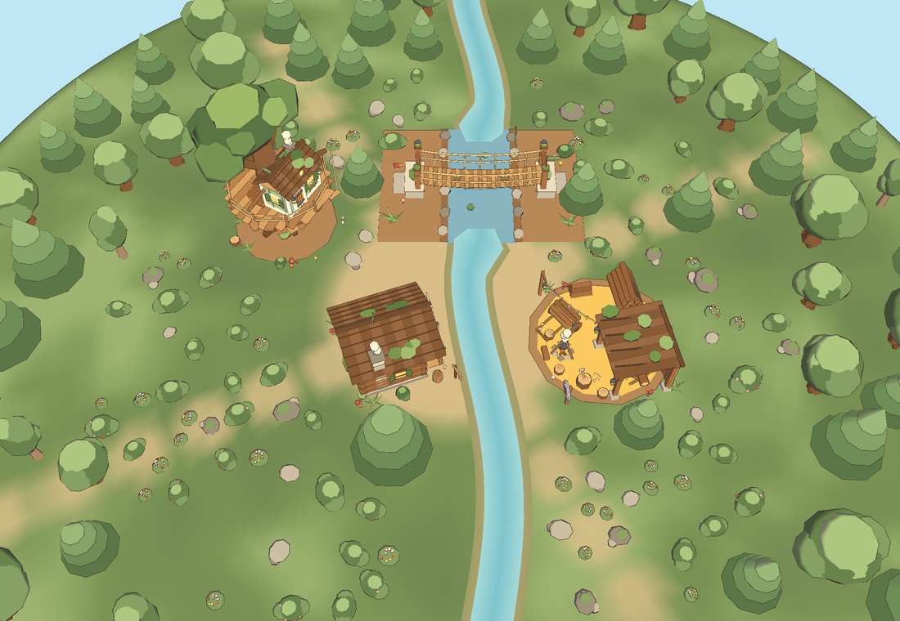
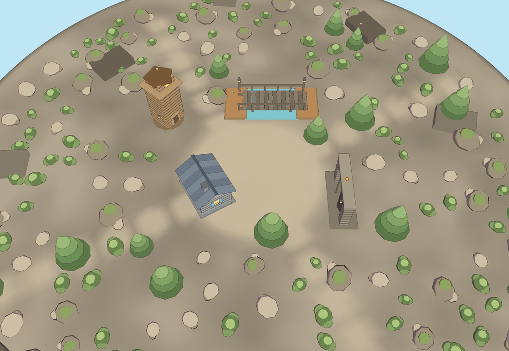

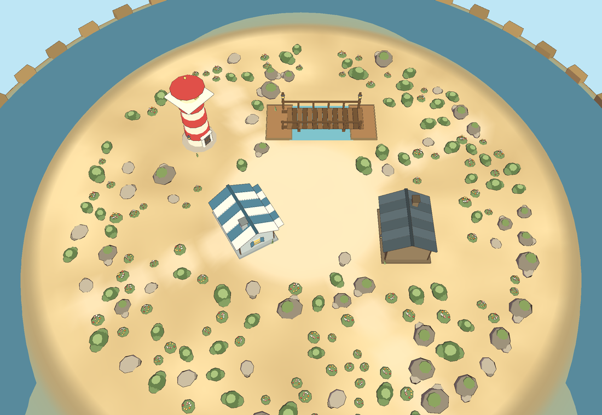
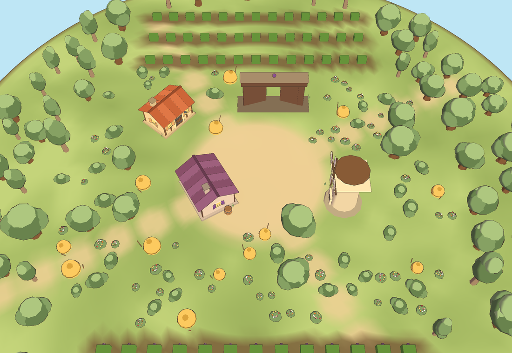

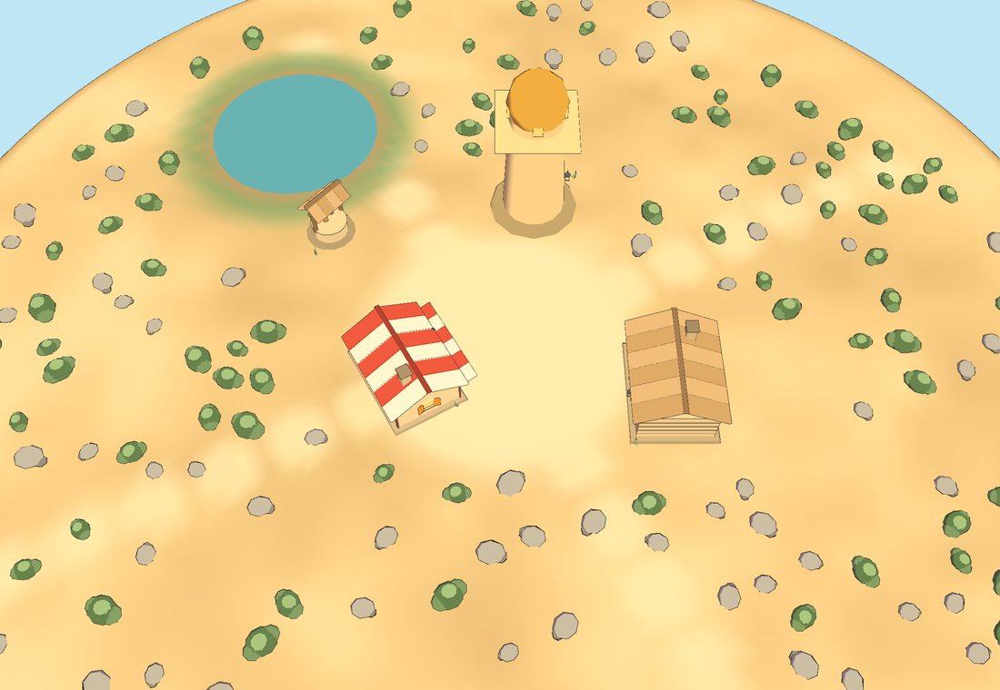
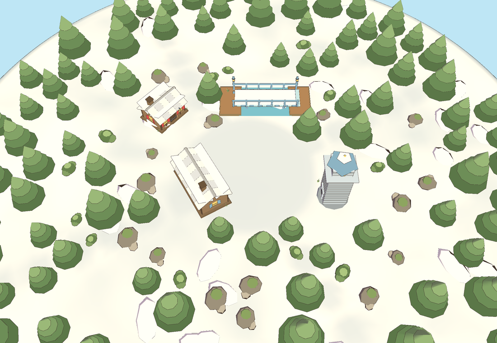

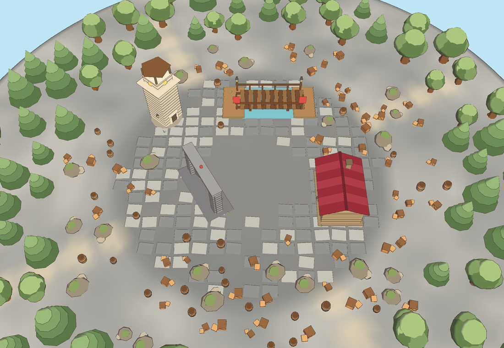

Whisperwood · Stonepeak · Saltcove · Vineyard Vale · Sunrise Oasis · Frostholm · Crown Keep

## Karakterler / Characters

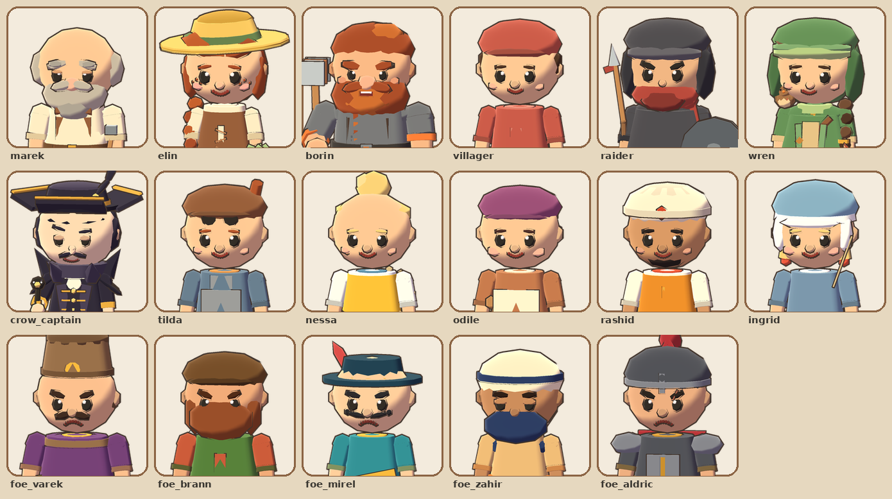

## Öne çıkanlar / Highlights

- 10 bölümde 100 seviye: ana köy (Onarım · Hasat · Savunma) ve altı bölge, Taç Kale ile biter / 100 levels in ten chapters, ending at the Crown Keep
- 18 zincirde 87 birleştirme ögesi, 14 üretici / 87 merge items in 18 chains and 14 producers
- 44 köy yapısı / 44 village buildings
- Türkçe ve İngilizce / English and Turkish
- Tüm dünya, arayüz ve sesler kodla üretilir / world, UI and sounds are generated from code
